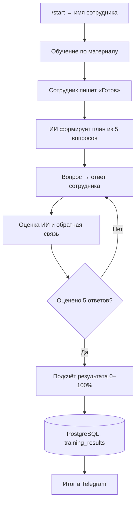

<div align="center">

# 🚚 ЛогистикПро

### AI Onboarding · Telegram Bot · Employee Training

Обучение логистов, проверка знаний и сохранение результатов — в одном Telegram-боте.


**Статус:** учебный MVP проверен локально · **Кейс:** PEcb07 · **Контрольный результат:** 4/5 — 80%

[Возможности](#-возможности) · [Как работает](#-как-работает) · [Запуск](#-быстрый-запуск) · [Проверка](#-проверка-результатов)

</div>

---

## ✨ О проекте

**ЛогистикПро** — Telegram-бот для адаптации новых сотрудников логистической компании. AI-наставник объясняет регламент, отвечает на вопросы по материалу, а затем проверяет знания в коротком тесте.

Проект демонстрирует полный цикл: от ввода имени и обучения до оценки ответов и записи результата в PostgreSQL. Тема и учебный материал настраиваются через переменные окружения.

## 🎯 Возможности

| Для сотрудника | Логика приложения |
|---|---|
| Обучение после ввода имени | Имя отделено от ответов на тест |
| Вопросы наставнику по материалу | Переход к тесту по сообщению «Готов» |
| Пять вопросов по одному | Вопросы генерируются одним планом с проверкой точных повторов |
| Обратная связь на каждый ответ | Порядок и номера задаются программой |
| Итог и рекомендации | Результат 0–100%, сохранение в PostgreSQL |
| Отмена через `/cancel` | Последовательная обработка сообщений одной сессии |

## 🔄 Как работает



ИИ формулирует вопросы и оценивает ответы. Программа управляет состоянием теста, порядком вопросов, подсчётом и завершением. Если сохранение не удалось, следующее сообщение повторяет сохранение без повторной оценки пятого ответа.

## 🛠️ Технологический стек

| Компонент | Технологии |
|---|---|
| Telegram-бот | Python 3.11, aiogram 3 |
| AI-наставник | API `/chat/completions`, JSON Schema, HTTPX |
| Модели данных | Pydantic, pydantic-settings |
| Хранение результатов | PostgreSQL 16, SQLAlchemy, asyncpg |
| Окружение | Docker, Docker Compose |
| Автотесты | unittest, AsyncMock, временная SQLite |

## 🚀 Быстрый запуск

Нужны Docker Desktop с запущенным Docker Engine, токен Telegram-бота и API-ключ провайдера с поддержкой `/chat/completions` и JSON Schema.

1. Клонируйте репозиторий:

   ```powershell
   git clone https://github.com/andrgol12-sys/logisticpro-onboarding.git
   cd logisticpro-onboarding
   ```
2. Создайте `.env` из примера (PowerShell):

   ```powershell
   Copy-Item .env.example .env
   ```

3. В `.env` заполните `BOT_TOKEN` и `OPENAI_API_KEY`. При необходимости измените `OPENAI_MODEL` и `OPENAI_BASE_URL` под своего провайдера. Тему и материал задают `TRAINING_TOPIC` и `TRAINING_MATERIAL`.
4. Запустите:

   ```powershell
   docker compose up --build -d
   docker compose logs --tail 30 bot
   ```

5. Откройте своего бота в Telegram: `/start` → имя → обучение → «Готов» → пять ответов.

В этой версии MVP тест всегда состоит ровно из пяти вопросов. Переменная `QUIZ_QUESTION_COUNT` оставлена для совместимости с исходной конфигурацией.

## ✅ Проверка результатов

Дайте четыре правильных ответа и один намеренно неправильный. Бот должен объяснить ошибку, завершить тест после пятого ответа и показать `4/5`, `80%` и подтверждение сохранения.

Проверенный результат проекта: тест завершён с оценкой **4/5 — 80%**, запись подтверждена через DBeaver в PostgreSQL.

### PostgreSQL и DBeaver

| Параметр | Значение |
|---|---|
| Хост | localhost |
| Порт | 5432 |
| База | onboarding |
| Пользователь | postgres |
| Пароль локальной учебной БД | postgres |

Таблица: `onboarding → public → training_results`.

```sql
SELECT id, employee_name, topic, total_questions,
       correct_answers, score_percent, created_at
FROM training_results
ORDER BY id DESC;
```

Внутри Docker бот подключается к хосту `db`, а DBeaver на компьютере — к `localhost`.

### Автоматические проверки

```powershell
docker compose run --rm --no-deps bot python -m unittest discover -s tests -v
```

Тесты проверяют все 32 сочетания правильных и неправильных ответов, порядок пяти вопросов, завершение, сохранение и повтор после ошибки БД. Для автоматических тестов используется временная SQLite; реальное сохранение в PostgreSQL также проверено отдельно.

## ⏹️ Остановка

```powershell
docker compose down
```

Данные PostgreSQL остаются в Docker volume. Текущая сессия обучения хранится в памяти и сбрасывается при перезапуске бота; сохранённые результаты остаются в БД.

## 📁 Структура проекта

```text
logisticpro-onboarding/
├── bot/
│   ├── handlers/onboarding.py      # Сценарий обучения и теста
│   ├── keyboards/                 # Клавиатуры Telegram
│   └── main.py                    # Запуск и изоляция событий
├── services/
│   ├── ai_training_service.py     # Запросы к ИИ
│   ├── ai_training_prompts.py     # Инструкции наставнику
│   └── training_service.py        # Порядок вопросов и подсчёт
├── schemas/training.py            # Состояние сессии и модели данных
├── database/                     # Таблица результатов и репозиторий
├── config/                       # Настройки окружения
├── tests/test_quiz.py             # Проверки логики и сохранения
├── .env.example                  # Пример настроек без ключей
├── .gitignore
├── .dockerignore
├── docker-compose.yml
├── Dockerfile
├── requirements.txt
├── main.py
└── README.md
```

## 🔒 Настройки и границы MVP

Файл `.env` содержит личные ключи и не включён в репозиторий и Docker-образ. Для настройки используется `.env.example` с демонстрационными значениями. Проект предназначен для локального учебного запуска.


## 👨‍💻 Автор проекта

**AIGolubev** · Python · AI-ассистенты · Telegram-боты · Автоматизация

[GitHub](https://github.com/andrgol12-sys) · [Сайт-портфолио](https://aigolubev.ru) · [Другие проекты](https://github.com/andrgol12-sys?tab=repositories)

Адаптация учебного проекта для кейса **PEcb07**.
